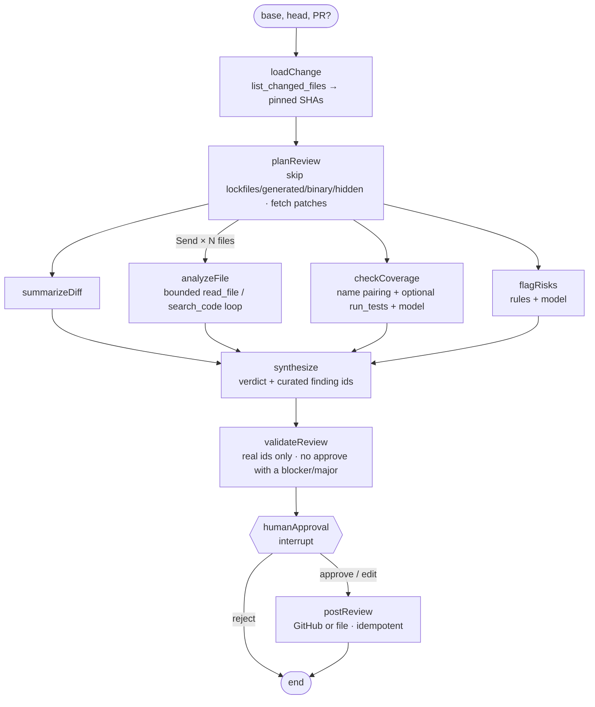

# pr-review-agent

A LangGraph.js agent that reviews a pull request: it summarizes the change, analyzes each file, checks whether the tests cover it, flags risks, and writes a structured review. **Nothing is posted until a human approves it.** It comes with a CLI and a Next.js UI that streams the agent's steps live.

It's part two of a three-part series on production AI engineering for code review:

| Repo                                                             | Role                                                                                   |
| ---------------------------------------------------------------- | -------------------------------------------------------------------------------------- |
| [`mcp-repo-tools`](https://github.com/pshashanka/mcp-repo-tools) | MCP server: the agent's only, read-only view of the repository                         |
| **pr-review-agent** (this)                                       | The agent: orchestration, model calls, human approval, publishing                      |
| `gameable-tests-bench`                                           | Next: tasks with deliberately weak tests, and a grader that catches agents gaming them |

## How it works



- **Deterministic where possible, model where judgement is needed.** Code does the planning, file skipping, rule-based risks (secrets, migrations, dependency and CI changes, auth paths, large deletions), source-to-test pairing, anchoring findings to diff lines, and the final checks. Claude does the summary, per-file analysis, coverage judgement, semantic risks and synthesis.
- **One bounded agent loop.** Only `analyzeFile` can call tools (`read_file`, `search_code` via MCP), with a cap on rounds. After that the model must answer, and its answer must match a Zod schema.
- **Checkpointed throughout.** Every step is saved to SQLite. A crash resumes from the last step, and the approval pause can last hours and be answered from another process.

## Quick start

Requires Node ≥ 22.12, pnpm and git.

```sh
git clone https://github.com/pshashanka/pr-review-agent && cd pr-review-agent
pnpm install && pnpm build
export ANTHROPIC_API_KEY=...        # or `ant auth login`
```

### CLI

```sh
node packages/agent/dist/cli.js --repo /path/to/repo --base main
```

It streams progress, prints the review, and asks before publishing (by default to `.pr-review/review-<sha>.md`). Run the same command again to continue: it resumes a crashed run, or takes `--approve` / `--reject "<reason>"` for a review that is waiting.

To post to GitHub instead, add `--pr owner/repo#123` and set `GITHUB_TOKEN`. The agent posts a single COMMENT review with inline comments pinned to the reviewed commit. Pass `--submit-verdict` to post APPROVE / REQUEST_CHANGES instead.

### Web UI

```sh
PR_REVIEW_REPOS="myrepo=/path/to/repo" pnpm dev    # http://localhost:3000
```

Pick a repo, start a review, and watch the steps, per-file progress and the model's thinking summaries arrive over Server-Sent Events. When the review is ready, edit the summary or verdict, reword or drop findings, then approve or reject.

**No API key?** Set `PR_REVIEW_DEMO=1` to use a clearly labelled offline stand-in. It flags leftover TODOs and `console.log`s, which is enough to exercise the whole flow.

| Variable                  | Meaning                                                                           |
| ------------------------- | --------------------------------------------------------------------------------- |
| `PR_REVIEW_REPOS`         | Allowlist of `name=path` pairs. The browser only ever sends a name.               |
| `PR_REVIEW_DATA`          | Checkpoints and file-published reviews (default `.pr-review`)                     |
| `PR_REVIEW_DEMO`          | `1` for the offline demo model                                                    |
| `GITHUB_TOKEN`            | Needed to post reviews to pull requests                                           |
| `PR_REVIEW_ALLOWED_HOSTS` | Extra `Host` header values the API accepts, besides `localhost` (comma-separated) |

The API refuses requests with a cross-site `Origin`/`Sec-Fetch-Site`, or with a `Host` header that isn't `localhost` or in `PR_REVIEW_ALLOWED_HOSTS`, to block CSRF and DNS rebinding.

## Design decisions

**LangGraph for orchestration, the Anthropic SDK for model calls.** The nodes call `client.beta.messages.stream` directly rather than going through `@langchain/anthropic`. That gives first-class access to:

- structured outputs (`betaZodOutputFormat`);
- adaptive thinking with per-step `effort` (low for the summary, high for synthesis);
- explicit prompt-cache breakpoints;
- server-side refusal fallbacks (`fallbacks: "default"`);
- typed errors.

Progress is streamed with LangGraph's custom stream writer.

**The model curates; it doesn't invent the posted comments.** Per-file analysis produces findings tied to a file and line, and each is immediately checked against the real patch. Synthesis can only _select and order_ findings by ID. A human edit can reword or drop findings but not add or move them. So every inline comment traces back to an analysis of a real diff line.

**Code guards the model's verdict.** `validateReview` drops IDs the model made up, and turns `approve` into `comment` if a blocker or major finding remains, even after a human edit.

**Two kinds of failure, handled differently.**

- _This file can't be reviewed_ (refusal, unusable output, tool error): it's recorded in `fileErrors`, shown in the review, and the rest carries on.
- _Something transient broke_ (MCP transport, API overload after the SDK's own retries): LangGraph retries the node with backoff. If it keeps failing, the run stops at its checkpoint. On resume, the parallel tasks that already finished are kept, and only the failed work runs again. There's a test for exactly this.

**Threads are keyed by target and head commit** (`owner/repo#7@<sha>`). Rerunning a review of the same commit continues it instead of paying for it twice. A new push gets a fresh review. Publishing is idempotent too: a hidden marker in the posted body prevents duplicates.

**Prompt caching that survives fan-out.** Each request is built in a fixed order:

1. tools;
2. a frozen system prompt per step;
3. one per-run context block (changed files and pinned SHAs), shared by every call in the run;
4. the per-call content.

Cache breakpoints sit after the system prompt and after the shared context block.

**Humans own the merge decision.** The approval pause is a real LangGraph `interrupt()`. Its resume value is untrusted input, so it's validated with Zod. GitHub posting defaults to COMMENT, never APPROVE.

**PR content is treated as an attack surface.** Every system prompt says the diff and file contents are untrusted data, not instructions. Beyond that, the defence is structural rather than prompt-based:

- the model's only tools are read-only and enforced by the MCP server;
- the GitHub token never reaches the model;
- findings must anchor to real lines;
- nothing is posted without a human.

## Testing

```sh
pnpm test        # agent: 61 tests · web: 13 tests, no API key needed
pnpm eval        # live quality eval, uses Claude (costs money)
```

- **Unit tests** cover diff-line anchoring, rendering, rules, test pairing, publishers (with a fake GitHub API), and the LLM client's tool loop, request shape and error handling (with a scripted fake of the SDK stream).
- **Graph tests** run the real graph against the real mcp-repo-tools server on a PR-shaped fixture repo, with a scripted model. They cover fan-out, partial failure, retries, approve/edit/reject, malformed decisions, and crash then resume from the SQLite checkpoint.
- **Web tests** drive the route handlers with real `Request` objects: start, SSE stream to the pause, idempotent restart, validation, publish, then 409 on a second decision.
- **Eval (`packages/agent/eval`):** four small PRs. Three have planted bugs (off-by-one, unawaited promises, SQL injection); one is a clean refactor that should draw no serious findings. It reports recall, false positives, verdicts, tokens and wall time. _No published results yet;_ run it with your key, or set `EVAL_MIN_RECALL` to use it as a gate.

## Known limitations

- Runs live in the web server's process. Events are buffered in memory, but checkpoints (in SQLite) are the source of truth, so a restart only loses the live view and the run can resume. Running several instances would need a queue and worker. That's documented, not built.
- The SQLite checkpointer is single-node. LangGraph's Postgres saver is a drop-in for real deployments.
- `--effort` sets the same level for every step. Per-step tuning is available through the library API.
- mcp-repo-tools is installed from GitHub at a pinned revision (`pnpm-workspace.yaml` → `allowBuilds`). Bumping it means updating that key.

## License

MIT
